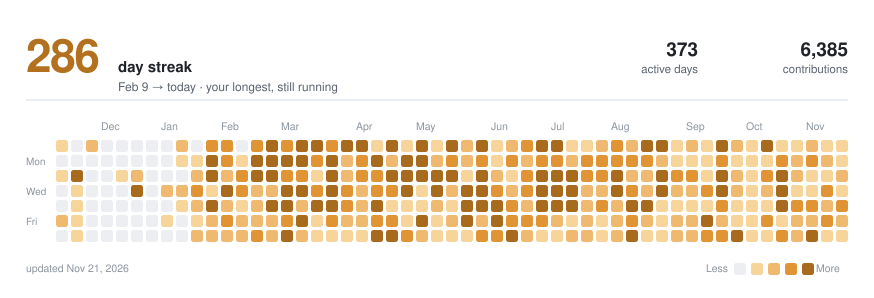

# Santo

Systems and AI engineering. CS at UT Dallas, graduating August 2027. Dallas, TX.

Three threads run through what I build lately. **Robots that learn to move**: walking policies trained in simulation, servos identified on a bench, and safety enforced below the code that might fail. **Cache correctness in LLM serving**: the bugs where a gateway or engine quietly stops reusing work it already paid for. And **tools I actually run**, because the ones in daily use are the ones that get finished.

A repo is easy to describe and hard to verify, so the list below is ordered by how little you have to take my word for.

## Merged upstream

*Reviewed and merged by the maintainers of someone else's project.*

- **[BerriAI/litellm](https://github.com/BerriAI/litellm)** - a hoisted mid-conversation system message rewrote the cached prompt prefix, so every turn re-billed at cache-write prices. The reporter's production cache-creation tokens fell from 1,746 to 60, with regression tests across Bedrock, Vertex, and Azure. [#36968](https://github.com/BerriAI/litellm/pull/36968), [#36969](https://github.com/BerriAI/litellm/pull/36969), and [#42630](https://github.com/BerriAI/litellm/pull/42630), which carried my commits from #38053

In review:

- **[NVIDIA/TensorRT-LLM #18160](https://github.com/NVIDIA/TensorRT-LLM/pull/18160)** - the KV-cache-aware router dropped the request's LoRA id, so every adapter request matched zero cached blocks and routing fell back to load balancing without an error. Two maintainer approvals
- **[vllm-project/vllm #53769](https://github.com/vllm-project/vllm/pull/53769)** - a conformance suite for KV-cache key partitioning, plus [#53496](https://github.com/vllm-project/vllm/pull/53496), which keys ExampleConnector storage on block hashes
- **[Nova-UTD/navigator #510](https://github.com/Nova-UTD/navigator/pull/510)** - for the UT Dallas autonomous-vehicle team: found the neural planner never loaded its checkpoint, then added launch-time planner selection and a benchmark scoring all five planners on validity, cost against the optimum, and runtime against the 100 ms loop

## Rerun it yourself

*The claim, the data behind it, and the script that produced it are all in the repo.*

- **[biped-in-desmos](https://github.com/oneKn8/biped-in-desmos)** - a ragdoll learns to walk inside the Desmos graphing calculator. Physics, a 52-parameter policy, evolution strategies, and the walking test are all Desmos expressions: 129 ragdolls learn from zero and pass a strict walking test in 16 generations, about five minutes, matching a float64 numpy reference to 1.9e-12. [Watch it learn](https://www.desmos.com/calculator/zzd5dnayog)
- **[transformer-in-desmos](https://github.com/oneKn8/transformer-in-desmos)** - two transformers in the same calculator. A 105k-parameter character model writes text with per-head ablation switches, logits matching numpy to 1e-14. A one-layer model trains in the graph with a hand-written backward pass and AdamW, and groks (a+b) mod 31 to 99.2% held-out at step 587 (numpy: 590)
- **[bengali-tokenizer-eval](https://github.com/oneKn8/bengali-tokenizer-eval)** - tokenizer choice changes what Bengali costs you by 5 to 9x. Thirteen SentencePiece tokenizers against nine public ones, with the worst failures traced to one character: leave U+09BC out of normalization and byte-fallback climbs from 2% to 20%. Ships the tokenizers, the 3,000-document benchmark, a per-document SHA-256 manifest, frozen results, and the paper

## Install it and see

*Published, deployed, or running on my machine right now.*

- **[openlock_browser](https://github.com/oneKn8/openlock_browser)** - a lockdown exam browser for Linux that speaks the Safe Exam Browser protocol (browser exam key, config key, RNCryptor v3), with a kiosk shell and a cgroup process guard. Has outside contributors, and a Debian Developer has filed to package it ([ITP #1140740](https://bugs.debian.org/1140740))
- **[undertone](https://github.com/oneKn8/undertone)** - hold a key, speak, release, and the words land in whatever window has focus. Groq Whisper with a local faster-whisper fallback, cleanup guarded against rewriting your slang into corporate English, and clipboard-plus-evdev injection for apps that refuse synthetic keystrokes. `pipx install undertone`, runs as a systemd service, and is how I dictate most of my own text
- **[glyphlab](https://glyphlab-rose.vercel.app)** - any image into character art without uploading it. ASCII, Braille, halftone, sextants, contour tracing, exported as selectable text, ANSI, GIF, or a playable terminal movie. Also emits buildable LEGO and cross-stitch charts using real BrickLink part numbers and DMC floss codes

## Read the mechanism

*The interesting part is a specific mechanism, and it is in the source rather than in a dependency.*

- **[imp](https://github.com/oneKn8/imp)** - a desk robot with an untrusted brain and a hardware conscience: safety is enforced below the host, on the servo bus. On a simulated SO-101 arm, 9 of 9 adversarial policies breach the unfiltered arm and 0 of 9 get past the control-barrier-function filter, at a p99 of 349 µs
- **[muzzle](https://github.com/oneKn8/muzzle)** - the servo-bus layer under imp: a streaming Feetech frame parser in C++17 for the ESP32-C3, with no heap, exceptions, or RTTI, differentially fuzzed. 31.8 cycles per byte, and direct UART FIFO reads at 10.1 µs per byte against roughly 30 to 40 through Arduino `Serial`
- **[vitals](https://github.com/oneKn8/vitals)** - see your own pulse on a webcam. Eulerian video magnification and FFT-based rPPG, with the bandpass and peak-picking math in the source rather than a DSP crate

## Take my word for it, for now

*Private until it is ready. Ask and I will walk you through it.*

- **stampede** - sim-to-real biped RL. MuJoCo Warp steps 4,096 robots in lockstep on one RTX 3090, about 115k samples a second end to end, and walking policies for a 10-joint biped go from 47% to 93% survival under a push-recovery curriculum. The Feetech STS3215 servos were identified on a bench from their own telemetry, and that derate-and-trip model feeds both simulators

Earlier: [bangla-llm](https://github.com/oneKn8/bangla-llm) · [soniq](https://github.com/oneKn8/soniq) · [agentgov](https://github.com/oneKn8/agentgov) · [machine-memory](https://github.com/oneKn8/machine-memory) · [lifeagent](https://github.com/oneKn8/lifeagent) · [Research-Agent](https://github.com/oneKn8/Research-Agent) · [drift](https://github.com/oneKn8/drift) · [slopguard](https://github.com/oneKn8/slopguard) · [profgraph](https://github.com/oneKn8/profgraph)

---

## Currently green

  
  
  

  <picture>
    <source media="(prefers-color-scheme: dark)" srcset="https://raw.githubusercontent.com/oneKn8/oneKn8/main/assets/streak-dark.svg?v=20261122">
    
  </picture>

---

